# Heurísticas de detección del Bad Smell *Class/Interface Mismatch* (CIM)

### Definición concreta, modelo de información y algoritmo de detección sobre el AST de PlantUML

> Documento complementario de [CIM.md](./CIM.md). `CIM.md` fija las definiciones UML y la
> sintaxis PlantUML utilizada; este documento define **qué** se detecta exactamente
> (definición concreta), **sobre qué información** del árbol de sintaxis, y **cómo**
> (heurísticas, normalización y pseudocódigo del algoritmo).
> Convención de citas idéntica a `CIM.md`: (fuente, líneas, página).

---

## Cómo leer este documento (mapa y glosario llano)

> Esta sección existe porque el resto usa terminología de UML y de algoritmos sin
> traducirla. Si algo de §3 en adelante no cierra, la respuesta está acá.

### El hilo: una sola pregunta

Todo el documento responde **«¿esta clase cumple lo que promete esta interfaz?»**. Cada
sección resuelve un sub-problema de esa pregunta:

| § | Sub-problema | En una frase |
|---|---|---|
| 3 | ¿Qué datos necesito? | Convertir el árbol en cajas (con sus miembros adentro) y flechas |
| 4 | ¿Cómo hago comparables esos datos? | Que `buscar(id:String)` y `buscar(id : String)` sean *lo mismo* |
| 5 | ¿Cuáles son las formas de incumplir? | Las 6 maneras concretas (H1–H6) |
| 6 | ¿En qué orden las ejecuto? | El pseudocódigo |
| 7 | ¿Cómo lo reporto de forma creíble? | Cada hallazgo con su evidencia |
| 8 | ¿Cómo sé que no me equivoqué? | 10 diagramas con resultado esperado |
| 9-10 | ¿Qué no puedo detectar y cómo lo mido? | Límites declarados y métricas |

### La imagen que explica el smell

Una **interfaz es el manual de un electrodoméstico**; una **clase es el aparato** que
declara cumplir ese manual. El smell es: el aparato declara cumplirlo y **le falta un botón
que el manual promete**. No importa si el aparato tiene botones de más (§2.1, "cubrir de
más está permitido"): importa que no falte ninguno de los prometidos.

### Glosario

| Término | Qué significa en castellano |
|---|---|
| **Clasificador** | Cualquier caja con nombre del diagrama (clase, interfaz, enum). Es el término de UML para "cosa con nombre" |
| **Miembro** | Una línea adentro de la caja: un atributo o una operación |
| **Operación** | Miembro **con paréntesis** (`area()`, `buscar(id : String)`). Sólo las operaciones forman parte de un contrato |
| **Atributo** | Miembro **sin paréntesis** (`radio : Double`). Se descarta para CIM (§4.1) |
| **Realización** | La flecha punteada con triángulo hueco (`..|>`, `<|..`) o la palabra `implements`: "yo cumplo este manual" |
| **Cliente / proveedor** | Cliente = la clase (recibe la obligación); proveedor = la interfaz (la impone). El libro dice "el **cliente** debe tener todas las operaciones del **proveedor**" (p. 55) |
| **`contrato(I)`** | La lista de lo que la interfaz promete. **En nuestro esquema, sólo lo que declara esa interfaz**, sin sumar operaciones de otras interfaces (§2.3) |
| **`disponibles(C)`** | La lista completa de lo que la clase sabe hacer, **incluyendo lo que hereda de sus superclases** |
| **Cierre de herencia** | La operación de **subir por la jerarquía y juntar todo**: "lo mío, y lo de mi padre, y lo del padre de mi padre…". Eso es todo lo que significa "cierre". En nuestro esquema se aplica **sólo a clases** (§4.3) |
| **Asimetría de los cierres** | Las dos listas se arman **por caminos separados**: `disponibles` sube por clases, `contrato` no sube por ningún lado. Nunca se usa una interfaz que la clase también implementa para tapar el hueco de otra (§4.3) |
| **Firma canónica** | La "identidad" del método, uniformada para poder comparar: se borran espacios, nombre del parámetro y genéricos. Es comparable a comparar documentos en vez de comparar cómo está escrito el nombre |
| **Heurística** | Regla del tipo "si pasa X, hay mismatch", con un grado de confianza asociado. No es una demostración |
| **Falso positivo / negativo** | Acusar al inocente / dejar libre al culpable. §4 existe para bajar falsos positivos |
| **Evidencia** | Texto que justifica un hallazgo para que un humano lo verifique sin leer el código (§7.1) |
| **Severidad vs. confianza** | Cuánto duele el problema / cuánto creo que realmente lo es. Son dimensiones distintas |
| **Determinismo** | El mismo diagrama produce siempre la misma salida, en el mismo orden (§7.3) |

---

## Conceptos previos (citas textuales de las fuentes)

> Las citas se transcriben **tal cual** aparecen en las fuentes, uniendo los cortes de
> línea del PDF. Los números de página del libro se reconstruyeron a partir de sus
> encabezados/pies (`p. 55`, `p. 56`, etc.), por lo que ante una diferencia de una página
> respecto de una edición impresa distinta, la referencia válida es la de líneas.

### Realización: qué es y qué exige

La relación que el detector analiza está definida en el libro así:

> «La relación de realización (Figura 4.9) conecta a un elemento del modelo, como una
> clase, con otro elemento del modelo, como una interfaz, que le proporciona su
> especificación de comportamiento, pero no su estructura o implementación.»
> (Libro-UML.md, líneas 2395-2399, p. 55)

Y, en la misma definición, la regla que fija el criterio de detección:

> «**El cliente debe tener (por herencia o por declaración directa) al menos todas las
> operaciones que tiene el proveedor.**»
> (Libro-UML.md, líneas 2399-2402, p. 55)

**Por qué importa**: son las dos frases que definen el smell. La primera dice qué se
compara (especificación contra implementación, no dos implementaciones); la segunda
—la **regla de completitud**— dice que el incumplimiento se mide sobre las operaciones
del proveedor, contando lo heredado. Todo el §5 se deriva de esta segunda frase, y de ella
sale también la asimetría del §4.3: se recorre el contrato de la interfaz, no los miembros
de la clase.

La misma idea, formulada desde la relación concreta, aparece en el glosario:

> «dependencia de implementación: Relación de realización entre una interfaz y una clase
> en la que **la clase se ajusta al contrato especificado por la interfaz**.»
> (Libro-UML.md, líneas 9708-9710, p. 253)

**Por qué importa**: "ajustarse al contrato" es exactamente lo que el detector verifica.
El mismatch es la negación de esa frase, sin necesidad de definir nada nuevo.

### Interfaz como contrato

> «interfaz: Declaración de un conjunto coherente de características y obligaciones
> públicas; **contrato entre proveedores y consumidores de servicios**.»
> (Libro-UML.md, líneas 15207-15209, p. 395)

> «Una interfaz no tiene instancias directas. **Una interfaz representa un contrato que
> debe ser cumplimentado por instancias de clasificadores que realizan la interfaz.**»
> (Libro-UML.md, líneas 15231-15232, p. 395)

**Por qué importa**: justifica tomar a la interfaz como patrón de comparación. Si la
interfaz es el contrato, el incumplimiento es objetivo y no una cuestión de estilo.

### El contenido de una interfaz es público

> «Una interfaz no tiene aspecto privado; todo su contenido es público.»
> (Libro-UML.md, línea 15220, p. 395)

> «Todas las características de una interfaz tienen visibilidad pública (por el contrario,
> no habrá punto para incluirlas, ya que una interfaz no tiene nada "dentro" que pueda
> usarlas).»
> (Libro-UML.md, líneas 15226-15229, p. 395)

**Por qué importa**: es el fundamento de **H3**. Si la interfaz es pública por definición,
una implementación con visibilidad menor no puede satisfacerla; no es una convención de
estilo, es una imposibilidad del modelo.

### Completitud: servicios, no estructura

La regla de completitud es sobre operaciones, no sobre forma interna:

> «Un clasificador que implementa una interfaz no necesita tener la misma estructura
> exacta que la interfaz; simplemente debe proporcionar los mismos servicios a los
> solicitantes externos.»
> (Libro-UML.md, líneas 15237-15239, p. 395)

**Por qué importa**: prohíbe comparar atributos y prohíbe exigir simetría. El detector sólo
mira operaciones del contrato, y una clase que declara **más** operaciones que la interfaz
sigue siendo conforme (regla del "al menos todas" de la p. 55). Sin esta cita, H2 sería
fácil de implementar mal (comparando conjuntos por igualdad en lugar de por inclusión).

Además, las interfaces se completan por generalización:

> «Las interfaces pueden tener relaciones de generalización. Una interfaz hija incluye
> todo el contenido de sus antecesores pero puede añadir contenido adicional.»
> (Libro-UML.md, líneas 15222-15224, p. 395)

**Por qué importa**: es la razón de que el contrato de una interfaz deba calcularse con
cierre sobre sus superinterfaces (§4.3). Sin esto, `Lista` que extiende `Coleccion` se
evaluaría con la mitad de su contrato.

### Capacidad de sustitución: por qué el mismatch es un problema

> «El principio mediante el cual, a partir de una declaración de una variable o parámetro,
> cuyo tipo se declara como X, cualquier instancia de una clase que sea descendiente de X
> puede ser usada como valor real, sin violar la semántica de la declaración y su uso.»
> (Libro-UML.md, líneas 20482-20486, p. 529)

> «**La consecuencia del principio de sustitución es que un hijo no puede eliminar ni
> renunciar a las propiedades de su padre.** De lo contrario, el hijo no sería sustituible
> en una situación en la que se declara el uso de su padre.»
> (Libro-UML.md, líneas 20496-20498, pp. 529-530)

**Por qué importa**: es la justificación de **severidad**. Un mismatch no es una
inconsistencia cosmética del diagrama: la clase no puede ocupar el lugar de la interfaz,
y todo código cliente escrito contra el contrato se rompe en ejecución. Por eso H1, H2 y
H5 son de severidad alta.

### Cómo se expresa todo esto en PlantUML

Las relaciones de clase:

> «Implementación `<|..` — Realización de una interfaz mediante una clase»
> (PlantUML_Guia.md, línea 1918, p. 58)

> «Es posible intercambiar `--` por `..` para tener lineas punteadas.»
> (PlantUML_Guia.md, línea 1923, p. 58)

con los ejemplos `Class11 <|.. Class12` (línea 1933) y `Class17 ..|> Class18` (línea 1936),
ambos en la p. 58.

Las palabras clave equivalentes:

> «It is also possible to use `extends` and `implements` keywords.»
> (PlantUML_Guia.md, línea 3006, p. 82)

con `class ArrayList implements List` y `class ArrayList extends AbstractList`
(líneas 3008-3009, p. 82), y la forma múltiple `class A extends B, C`
(líneas 3019-3021, p. 82).

La declaración de los elementos analizados:

> «Puedes declarar una clase como abstracta usando las palabras claves `abstract` or
> `abstract class`.» / «Puedes usar también las palabras claves `interface`, `annotation`
> and `enum`.»
> (PlantUML_Guia.md, líneas 2314-2316, p. 66)

**Por qué importa**: el parser debe reconocer la realización por **cuatro vías** (dos
flechas y dos palabras clave), porque PlantUML las considera equivalentes. Un detector que
sólo mire `<|..` pierde silenciosamente todos los diagramas escritos con `implements`
(§3.2).

---

## 1. Propósito y alcance

Este documento especifica el criterio de detección del bad smell **class/interface
mismatch** para el analizador que trabaja sobre el árbol de sintaxis generado por ANTLR
a partir de diagramas de clases PlantUML (v1.2025.0).

El objetivo es doble:

1. **Definir con precisión el smell**, de modo que dos personas del equipo, frente al
   mismo diagrama, coincidan en si hay o no hay mismatch y en cuál es la evidencia.
2. **Especificar la detección** en términos implementables: información a extraer del
   AST, normalizaciones previas, catálogo de heurísticas con su confianza y el
   pseudocódigo del recorrido.

**Fuera de alcance de este documento**: la gramática ANTLR concreta de PlantUML de
clases (se asume provista) y el refactoring sugerido para cada hallazgo (se menciona sólo
como salida informativa).

---

## 2. Definición concreta: cuándo hay mismatch

### 2.1 Definición adoptada (estricta)

> **Hay *class/interface mismatch* cuando un clasificador concreto (clase) declara una
> relación de realización con una interfaz —o la implementa mediante `implements`— y no
> satisface el contrato de esa interfaz**: le falta alguna de sus operaciones, o la
> operación declarada no es compatible en firma, visibilidad, tipo de retorno o
> naturaleza (instancia vs. estática).

Esta definición se apoya en la regla de realización de UML: la realización «conecta a un
elemento del modelo, como una clase, con otro elemento del modelo, como una interfaz, que
le proporciona su especificación de comportamiento, pero no su estructura o
implementación. **El cliente debe tener (por herencia o por declaración directa) al
menos todas las operaciones que tiene el proveedor**» (Libro-UML.md, líneas 2395-2401,
p. 55; concordante con «cada clase implementa las operaciones que se encuentran en la
interfaz», Libro-UML.md, líneas 1997-1999, p. 46 y 2083-2086, p. 48).

De la regla se derivan dos consecuencias que el detector **debe** respetar:

- **La interfaz es el patrón de comparación**, no la clase: se recorre el contrato y se
  verifica que la clase lo cubra, nunca al revés.
- **Cubrir de más está permitido**: una clase puede declarar operaciones adicionales a
  las de la interfaz. Eso **no** es mismatch (la regla pide «al menos todas las
  operaciones del proveedor»).

### 2.2 Delimitación frente a smells vecinos

| Situación observada | ¿Es CIM? | Motivo |
|---|---|---|
| Clase realiza interfaz y le falta una operación | **Sí** | Viola la regla de completitud (p. 55) |
| Clase realiza interfaz con la operación pero firma incompatible | **Sí** | La operación no satisface el contrato |
| Clase realiza interfaz con la operación pero visibilidad reducida | **Sí** | No es invocable a través del contrato |
| Clase abstracta que difiere operaciones a sus subclases | No (informativo) | La realización es legítimamente incompleta en un tipo abstracto |
| Interfaz sin operaciones (`interface Vacía`) | No | No hay contrato que incumplir |
| Clase con muchos métodos y ninguna interfaz | No | Es *Large Class*, no CIM |
| Jerarquía de clases donde una subclase rehúsa métodos heredados | No | Es *Refused Bequest* |
| `implements` sobre un nombre no declarado como `interface` | No | Error/ambigüedad de modelo, se reporta como validación aparte (§8) |

La última fila es importante: el smell presupone que el proveedor **es** una interfaz. Si
el diagrama declara `class Servicio` y `class Cliente implements Servicio`, el problema es
de clasificación del elemento, no de contrato, y se emite como advertencia de modelo, no
como CIM.

### 2.3 Qué queda fuera de nuestro esquema

El detector verifica **una relación de implementación por vez, entre una interfaz y la clase
que la implementa**. Hay dos situaciones que involucran varias interfaces o varias clases y
que **no** forman parte de nuestro esquema:

| Fuera de alcance | Ejemplo | Por qué queda afuera |
|---|---|---|
| **Herencia entre interfaces** (una interfaz extiende otra) | `interface Lista <|-- interface Coleccion` | El contrato de `Lista` se toma **literal**: sólo las operaciones que declara `Lista`. No se le suman las de `Coleccion`, así que tampoco se exige a la clase que las cubra por esa vía |
| **Una clase que implementa varias interfaces** | `class ArrayList implements Lista, Serializable` | Sólo se analiza la **primera** interfaz; las demás se informan como `NO_ANALIZADA` (§2.4) |

**Qué hace el detector si las encuentra**: no las ignora en silencio. La relación
interfaz-interfaz se descarta al armar las relaciones de realización (no es una realización),
y la clase con dos interfaces genera **una sola evaluación**, contra la primera interfaz
de su declaración (§2.4).

**Consecuencia a declarar en el informe**: es un recorte deliberado de alcance, no un
descuido. El precio es que un diagrama con jerarquías de interfaces puede producir hallazgos
que un lector humano consideraría cubiertos por la superinterfaz. Eso está anotado en §9.

### 2.4 Sólo se analiza la primera interfaz de cada clase

Cuando una clase implementa varias interfaces, **el análisis se hace únicamente sobre la
primera**, entendiendo por "primera" la que aparece primero en el orden de declaración del
diagrama (la flecha o el `implements` que está más arriba en el archivo).

```plantuml
@startuml
interface Guardable { +guardar() : void }
interface Serializable { +serializar() : String }
class Documento implements Guardable, Serializable {
  +guardar() : void
}
@enduml
```

En este diagrama se analiza **`Documento` contra `Guardable`** (conforme). La relación con
`Serializable` **no se evalúa**: no se reporta que falte `serializar`, ni se compara un
contrato con el otro.

Las interfaces no analizadas no se descartan en silencio: se emite un aviso
`NO_ANALIZADA` indicando cuáles quedaron afuera, para que el informe pueda decir con
precisión qué se miró y qué no (§7.1).

---

## Panorama: el algoritmo de un vistazo (antes del detalle)

> Esta sección es el mapa. Los §3 a §7 son el mismo camino, contado paso por paso.

### De dónde sale cada cosa

El punto de partida es **una definición**, no una idea de implementación: hay mismatch
cuando una clase declara implementar una interfaz y no cumple su contrato (p. 55, §2.1).

De esa definición sale, en cascada, todo lo demás. Cada flecha es una pregunta, y la
respuesta a esa pregunta es una sección del documento:

```
   DEFINICIÓN (Libro UML, p. 55)
   "el cliente debe tener al menos todas las
    operaciones que tiene el proveedor"
              │
              │  ① ¿qué necesito para poder afirmar o negar eso?
              ▼
   DATOS NECESARIOS
   · las operaciones que promete la interfaz
   · las operaciones que ofrece la clase (con lo que hereda)
   · qué clase implementa qué interfaz
              │
              │  ② ¿de dónde los saco?
              ▼
   DEL ÁRBOL DE ANTLR  ──────────────►  MODELO DEL DIAGRAMA  (§3)
   cajas · miembros · relaciones
              │
              │  ③ ¿el árbol ya me da "operaciones"?
              ▼
   NO: el árbol tiene TEXTO, no operaciones.
   "+buscar(id : String) : Entidad" es una cadena de tokens.
   Hay que DECIDIR qué parte es nombre, qué son parámetros,
   qué es retorno y qué es visibilidad  ──►  §4.1
              │
              │  ④ ¿ahora puedo comparar?
              ▼
   TODAVÍA NO: dos escrituras del mismo método no coinciden.
   buscar(id : String)  ≠  buscar(id:String)
   Hay que definir cuándo dos operaciones son "la misma"  ──►  §4.2
              │
              │  ⑤ ¿falta algo? Sí: lo que la clase hereda de sus
              │     superclases también cuenta como propio  ──►  §4.3
              │
              │  ⑥ ¿cómo comparo las dos listas?
              ▼
   HEURÍSTICAS (§5)  =  las 6 formas en que la resta puede fallar
   H1 falta · H2 firma · H3 visibilidad · H4 estática · H5 diferida · H6 retorno
              │
              ▼
   HALLAZGOS con evidencia (§7)
```

### El dato pasa por tres estados

El punto ② y el punto ④ parecen el mismo paso, pero no lo son. Entre el árbol y la
comparación el dato se transforma **dos veces**, y cada transformación resuelve un problema
distinto:

| Estado | Qué tengo | Ejemplo | ¿Se puede comparar? |
|---|---|---|---|
| **1. Texto del árbol** | una cadena de tokens, tal como está escrita | `+buscar(id : String) : Entidad` | **No.** Es texto: cualquier diferencia de espacios lo hace distinto |
| **2. Miembro** | los campos separados (estructura) | `nombre = buscar`<br/>`parametros = [id : String]`<br/>`retorno = Entidad`<br/>`visibilidad = +` | **Todavía no.** Mismo método escrito distinto sigue dando estructuras distintas (`String id` vs `id : String`) |
| **3. Firma canónica** | la identidad del método, uniformada | `buscar(String)` | **Sí.** Es un valor comparable |

- El salto **1 → 2** es **leer** el miembro: decidir dónde empieza el nombre, dónde los
  parámetros, dónde el retorno (§4.1). Sin esta decisión no hay campos, sólo texto.
- El salto **2 → 3** es **normalizar** la firma: borrar lo que no cambia la identidad del
  método, para que dos escrituras equivalentes coincidan (§4.2). Sin esta decisión no hay
  criterio de igualdad.

Son dos problemas distintos: el primero es de **forma** (¿dónde está cada cosa?), el segundo
es de **criterio** (¿cuándo dos cosas son la misma?). Por eso son dos secciones.

### Redacción sugerida para el informe

> **Especificación de la detección**
>
> Para especificar qué datos es necesario extraer del árbol de sintaxis, partimos de la
> definición previamente planteada:
>
> *«El cliente debe tener al menos todas las operaciones que tiene el proveedor».*
>
> **1. ¿Qué necesitamos para poder afirmar o negar eso?** Tres datos:
>
> - la lista de operaciones que **promete la interfaz** (sólo las que declara esa interfaz,
>   §2.3);
> - la lista de operaciones que **ofrece la clase**, incluyendo las que hereda de sus
>   superclases (§4.3);
> - **qué clase implementa cuál interfaz** (sólo la primera si implementa varias, §2.4).
>
> **2. ¿De dónde los saco?** Del árbol producido por ANTLR. Pero el árbol sólo da texto:
> lo leo una sola vez y armo dos listas —cajas y relaciones—, guardando los miembros
> adentro de cada caja (§3).
>
> **3. ¿Ese texto ya es una operación?** No. Lo interpreto para separar nombre, parámetros,
> tipo de retorno y visibilidad (§4.1). Ahora sí tengo operaciones, pero escritas de
> cualquier forma.
>
> **4. ¿Puedo comparar?** Todavía no. Primero defino **cuándo dos escrituras son la misma
> operación** (la firma canónica, §4.2) y además resuelvo que **lo heredado por la clase
> cuenta como propio** (§4.3). Ahora sí.
>
> **5. ¿Cómo comparo?** Recorro el contrato de la interfaz y verifico cada operación contra
> lo disponible en la clase; las formas en que esa verificación puede fallar son las
> heurísticas del §5.

### El modelo concreto, con un ejemplo

Con este diagrama:

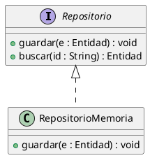

el paso por el árbol deja estas **dos listas** (con los miembros anidados dentro de cada caja):

| Lista | Contenido en este ejemplo |
|---|---|
| **Cajas** | `Repositorio` (tipo `INTERFAZ`, miembros: `guardar`, `buscar`)<br/>`RepositorioMemoria` (tipo `CLASE`, miembros: `guardar`) |
| **Relaciones** | `RepositorioMemoria` **implementa** `Repositorio` |

Los miembros no forman una lista aparte: cada caja lleva los suyos (`miembros[]`), porque
pertenecen a esa caja y no tienen sentido sueltos.

Y una vez normalizadas las firmas, la comparación es una resta:

| De la interfaz (contrato) | De la clase (disponibles) | Resultado |
|---|---|---|
| `guardar(Entidad)` | `guardar(Entidad)` | ✓ cubierta |
| `buscar(String)` | — | ✗ **H1: falta la operación** |

Eso es todo el detector. El resto del documento es el detalle de cada paso: qué campos
exactos tiene cada lista (§3), cómo se lee un miembro (§4.1), cómo se construye cada firma
(§4.2), qué más puede fallar además de "falta" (§5) y cómo se ejecuta todo en orden (§6).

---

## 3. Qué datos necesitamos sacarle al diagrama

Antes de detectar nada hay que decidir **con qué información vamos a trabajar**. La
tentación es recorrer el árbol de ANTLR directamente y resolver todo ahí adentro; el
problema es que ese árbol tiene la forma de la *gramática*, no la forma del *problema*.

Pensalo así: el árbol de ANTLR es como el índice de un libro (te dice dónde está cada
palabra, en qué renglón y en qué página), y nosotros queremos saber **quién promete qué**.
Son dos preguntas distintas. Si las mezclamos, cada heurística termina navegando el árbol a
su manera y ninguna se puede probar por separado.

Por eso hacemos un paso intermedio: leemos el árbol **una sola vez** y armamos una
estructura simple en memoria, el **modelo del diagrama**. Todas las heurísticas del §5 trabajan
sobre ese modelo, nunca sobre el árbol.

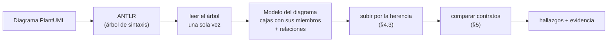

**La ventaja práctica**: cada heurística se convierte en una función que recibe dos listas
de métodos y devuelve hallazgos. Se puede testear con dos listas escritas a mano, sin
necesidad de armar un diagrama PlantUML. Y si un día cambia la gramática, se toca sólo la
lectura del árbol; las heurísticas quedan intactas.

### 3.1 Las dos listas (y por qué los miembros van adentro)

El modelo son **dos listas**: cajas y relaciones. La tercera pieza, los miembros, no es una
lista paralela: cada caja lleva los suyos.

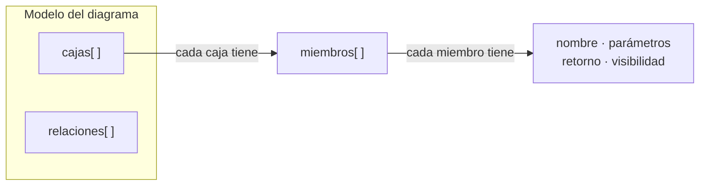

**Por qué anidados y no en una lista aparte**: un miembro siempre pertenece a *una* caja.
Si estuvieran sueltos habría que repetir en cada miembro a qué caja pertenece, y toda consulta
("¿qué declara `Repositorio`?") obligaría a filtrar una lista enorme. Anidados, la pregunta se
responde leyendo `Repositorio.miembros`.

**1. Las cajas** (en UML: *clasificadores*). Todo lo que tiene nombre y miembros:

| Campo | Para qué lo usamos |
|---|---|
| `nombre`, `alias` | Identificar la caja (§3.3) |
| `tipo` | Saber si es `INTERFAZ`, `CLASE`, `CLASE_ABSTRACT`, `ENUM` u `OTRO` |
| `esAbstracto` | Decidir si un hueco es smell o es legítimo (§7.2) |
| `miembros[]` | Su contenido |
| `linea` | Poder señalarlo en el diagrama |

Se leen de las palabras clave `class`, `interface`, `abstract class`, `abstract`, `entity`,
`enum` (PlantUML_Guia.md, líneas 1887-1911, p. 57).

> **Detalle**: un `enum` no puede ser el proveedor de una realización verificable (no
> promete operaciones en el sentido que nos interesa), así que lo guardamos como `OTRO` y
> queda fuera del análisis.

**2. Los miembros**. Cada línea adentro de una caja:

| Campo | Para qué lo usamos |
|---|---|
| `nombre` | Base de la comparación |
| `parametros[]`, `tipoRetorno` | La firma (§4.2) |
| `visibilidad` | H3: ¿es invocable desde afuera? |
| `esEstatico`, `esAbstracto` | H4 y H5 |
| `linea` | Evidencia |

Se leen de `: miembro`, del cuerpo `{ ... }` y de los modificadores `{static}` /
`{abstract}` (PlantUML_Guia.md, líneas 1985-2021, p. 60; 2102-2126, p. 62).

> **Detalle**: acá no distinguimos todavía entre atributo y operación. Eso pasa en el §4.1,
> que es donde se decide qué es un método y qué no.

**3. Las flechas** (en UML: *relaciones*): `origen`, `destino`, `tipo` y `linea`. Sólo nos
interesan las de realización y las de herencia; el resto se guarda pero no se usa.

### 3.2 Ojo: hay cuatro formas de decir "implemento"

Esto es más importante de lo que parece. PlantUML permite expresar la misma idea de cuatro
maneras distintas, y si el lector del árbol reconoce sólo una, el detector **pierde casos
sin avisar**: no falla, simplemente no encuentra nada.

| Cómo se escribe | Quién implementa a quién |
|---|---|
| `Interfaz <|.. Clase` | `Clase` implementa `Interfaz` |
| `Clase ..|> Interfaz` | ídem, con la flecha al revés |
| `class Clase implements Interfaz` | ídem, con palabra clave |
| `class Clase extends A, B` | puede ser herencia **o** implementación: depende de qué sea cada nombre |

Referencias: PlantUML_Guia.md, líneas 1914-1950, p. 58 (la tabla de símbolos y el ejemplo
`Class11 <|.. Class12` con `Class17 ..|> Class18` en las líneas 1933 y 1936);
líneas 3006-3009, p. 82 (`extends` e `implements`); líneas 3019-3021, p. 82 (la forma con
varios nombres).

La cuarta fila es la trampa: `class Auto extends Vehiculo, Vendible` no dice si `Vendible`
es interfaz o clase. Recién se sabe **después** de haber leído las cajas, mirando el `tipo`
de cada nombre. Si es `INTERFAZ` cuenta como realización; si es `CLASE` o `CLASE_ABSTRACT`,
cuenta como herencia.

También hay que normalizar las variantes de línea (`--`, `..`, `-`, `-left-`, `-up-`…):
cambian el dibujo, no el significado (PlantUML_Guia.md, líneas 2732-2748, p. 76).

**Ojo con la cuarta fila y con la forma `implements A, B`**: en nuestro esquema la
realización se toma **sólo clase → interfaz**, y de cada clase se analiza **una sola
interfaz**:

- una relación entre dos interfaces (`Coleccion <|-- Lista`, `A <|-- interface B`): no es una
  realización, se descarta al armar las relaciones y **no se sube por ella** para armar el
  contrato (§2.3);
- `class Documento implements Guardable, Serializable`: se conserva **sólo `Guardable`**
  (la primera de la lista). `Serializable` queda registrada como `NO_ANALIZADA` y no genera
  evaluación (§2.4).

**Las interfaces *lollipop*** (`bar ()- foo`, `bar ()-- foo`, `foo -() bar`;
PlantUML_Guia.md, líneas 2715-2731, p. 76) son un caso aparte: dicen que `foo` proporciona
la interfaz `bar`, pero **`bar` no tiene cuerpo en el diagrama**. Sin cuerpo no hay contrato
y sin contrato no hay nada que comparar. Se registran como `CONTRATO_DESCONOCIDO` y no
generan hallazgo (§8.8). Es una limitación, y en el informe se declara como tal.

### 3.3 Una misma caja puede aparecer varias veces

Antes de comparar hay que asegurarse de que cada caja es **una sola** en el modelo.

- `class "Nombre visible" as alias` y `class alias as "Nombre visible"` (PlantUML_Guia.md,
  líneas 1975-1983, p. 59): **la identidad es el alias**. El texto entre comillas es sólo
  una etiqueta para mostrar; lo que usan las flechas es el alias.
- Los nombres que empiezan con `$` sólo pueden tener alias entre comillas.
- PlantUML permite **completar una clase en varias líneas** o en varias declaraciones. Si
  aparece dos veces, sus miembros se **fusionan** en una sola caja.

Sin este paso, `Repositorio` y `Repo` podrían quedar como dos clasificadores distintos y
todo aparecería como faltante. Es barato de hacer y evita un desastre de falsos positivos.

---

## 4. Normalización previa a la comparación

Sin esta etapa, las heurísticas producen falsos positivos masivos. Cada normalización
existe por una razón concreta del lenguaje.

### 4.1 Declaración de un miembro

PlantUML es deliberadamente flexible con el orden de tipo y nombre, y decide entre campo
y método por la presencia de paréntesis (PlantUML_Guia.md, líneas 1985-2000, p. 60). Se
adopta la siguiente gramática de miembro:

```
miembro   ::= visibilidad? modificador? resto
visibilidad ::= '+' | '-' | '#' | '~'
modificador ::= '{static}' | '{abstract}' | '{classifier}' | '{field}' | '{method}'
resto     ::= <texto>
```

- Si `resto` contiene `(` → **operación**. `nombre` = token previo a `(`; `parametros` =
  contenido entre paréntesis separado por comas; `tipoRetorno` = texto anterior al nombre.
- Si no contiene `(` y no hay `{method}` → **atributo**; se descarta para CIM.
- `{field}` fuerza atributo, `{method}` fuerza operación (anula la heurística anterior).
- Tanto `{static}`/`{abstract}` al inicio como al final son válidos (PlantUML_Guia.md,
  líneas 2102-2126, p. 62).

### 4.2 Firma normalizada

Se compara una **firma canónica** y no el texto crudo:

```
firma(op) = minúsculas(op.nombre) + "(" + unir(normalizarTipo(p) ∀ p ∈ op.parametros, ",") + ")"
```

`normalizarTipo(t)`:

1. `trim` y colapso de espacios internos (`String  id` → `String id`);
2. eliminación del **nombre** del parámetro si está presente (`String id` → `String`), usando
   como criterio «si quedan dos tokens, el último es el nombre»;
3. borrado de genéricos (`List<Entidad>` → `List`), porque la parametrización no siempre se
   replica en la clase y no es evidencia de incumplimiento;
4. normalización de arreglos (`String[]`, `String [ ]` → `String[]`);
5. **no** se altera el case de los tipos (el case sí distingue tipos).

El **orden** de los parámetros se conserva: `enviar(Mensaje, Integer)` y
`enviar(Integer, Mensaje)` son firmas distintas.

### 4.3 Cierre de herencia (sólo para clases)

La regla de UML dice «por herencia o por declaración directa» (p. 55). En nuestro esquema,
"por herencia" se resuelve **sólo hacia arriba en las clases**; el contrato de la interfaz
se toma tal como está escrito.

| Conjunto | Cómo se arma |
|---|---|
| `contrato(I)` | **Sólo** las operaciones declaradas en `I`. No se suman las de las interfaces que `I` extienda (§2.3) |
| `disponibles(C)` | Operaciones declaradas en `C` **más** las heredadas de su cadena de superclases (`C <|-- D <|-- E`…) |

**Por qué `disponibles(C)` no incluye las interfaces realizadas**: si `C` realiza `J` e `I`
y `J` declara `op`, incluir `op` desde `J` haría que el incumplimiento de `J` se «contagie»
a `I` y desaparezca el hallazgo de `I`. Cada relación de realización se evalúa por separado;
el incumplimiento se reporta una vez por relación afectada (§7.3, deduplicación).

> **En llano**: de la clase subimos por sus clases padre y juntamos todo lo que sabe hacer
> (eso es la herencia, y es lo que permite cumplir un contrato sin repetir métodos). De la
> interfaz **no subimos a ninguna parte**: usamos exactamente los métodos que aparecen
> escritos adentro de esa interfaz en el diagrama. Y lo que la clase hereda por implementar
> otra interfaz no cuenta para esta: son contratos independientes.

El recorrido de la cadena de clases debe ser **tolerante a ciclos** (un diagrama mal modelado
puede contener `A <|-- B` y `B <|-- A`) y registrar un aviso de modelo, sin colgarse.

### 4.4 Abstracto

`esAbstracto` se propaga por dos vías: declaración (`abstract class` / `abstract`) y
operaciones abstractas (`{abstract}`). Es un dato de primera clase porque **cambia la
clasificación del hallazgo**, no su existencia (§5, H5).

---

## 5. Catálogo de heurísticas

Se definen **seis heurísticas** sobre el modelo normalizado, todas derivadas de la regla de
realización. Cada una es independiente y verificable: dado el modelo del diagrama y una relación de
realización `(C, I)`, su resultado es determinista.

Notación: para una operación `op ∈ contrato(I)`, `cand(op) = { d ∈ disponibles(C) |
nombre(d) = nombre(op) }`.

### H1 — Operación del contrato ausente (`FALTA_OPERACION`)

- **Condición**: `cand(op) = ∅`.
- **Evidencia**: `op` existe en `contrato(I)` y ninguna operación de `disponibles(C)` tiene
  ese nombre.
- **Justificación**: viola directamente «el cliente debe tener al menos todas las
  operaciones que tiene el proveedor» (Libro-UML.md, líneas 2395-2401, p. 55).
- **Confianza**: alta. Es el caso canónico del smell.
- **Falsos positivos típicos**: interfaz completada en otra hoja del diagrama; operación
  heredada por una superclase no declarada en el archivo. Mitigación: reportar siempre la
  cadena de búsqueda en la evidencia.

### H2 — Firma incompatible (`FIRMA_INCOMPATIBLE`)

- **Condición**: `cand(op) ≠ ∅` y `∀ d ∈ cand(op) : firma(d) ≠ firma(op)`.
- **Evidencia**: el nombre coincide pero ninguna sobrecarga satisface la firma canónica; se
  listan las firmas candidatas encontradas.
- **Justificación**: la operación existe con otro contrato; no hay sustituto polimórfico de
  `op` (la firma es la identidad de la operación en UML).
- **Confianza**: media-alta. Si el diagrama omite tipos de parámetros (`buscar(id)` vs
  `buscar(x)`), las firmas normalizadas coinciden y **no** se reporta; sólo se reporta
  cuando la incompatibilidad es explícita (distinto número de parámetros o tipos distintos
  declarados).
- **Nota**: un mismatch de *aridad* por sobrecarga es el falso positivo más frecuente en
  analizadores de contrato; por eso H2 exige que **ninguna** sobrecarga coincida.

### H3 — Visibilidad reducida (`VISIBILIDAD_REDUCIDA`)

- **Condición**: `cand(op) ≠ ∅`, con `d` de firma compatible, y
  `rango(d.visibilidad) < rango(op.visibilidad)`.
- **Escala**: `public(+) = 3`, `package(~) = 2`, `protected(#) = 1`, `private(-) = 0`
  (PlantUML_Guia.md, líneas 2051-2085, p. 61; visibilidad como restricción de uso,
  Libro-UML.md, líneas 1990-1996, p. 46).
- **Justificación**: una operación del contrato que la clase declara más restrictiva no es
  invocable a través de la interfaz; el contrato no se satisface aunque el nombre exista.
- **Confianza**: media. Si la visibilidad **no está declarada** en alguno de los dos lados,
  se asume `desconocida` y **no se reporta** (evita falsos positivos por omisión de `+`).

### H4 — Estaticidad incompatible (`ESTATICIDAD_INCOMPATIBLE`)

- **Condición**: `cand(op) ≠ ∅` con firma compatible y `d.esEstatico ≠ op.esEstatico`,
  siendo `op.esEstatico = false`.
- **Justificación**: las operaciones de una interfaz son de instancia; una implementación
  `{static}` no participa del despacho polimórfico y no puede sustituir a `op`.
- **Confianza**: media.
- **Alcance**: la combinación inversa (`op` estática, `d` de instancia) se marca como
  **informativa**, porque una interfaz con miembros estáticos es una construcción
  discutible en UML y no un incumplimiento del cliente.

### H5 — Implementación diferida en tipo concreto (`DIFERIDA_EN_CONCRETA`)

- **Condición**: `cand(op) = ∅` o sin firma compatible, y `C` **no** es abstracta, pero
  `disponibles(C)` contiene una operación con ese nombre marcada `{abstract}`; **o** la
  operación no existe pero la clase concreta se declara abstracta de forma inconsistente
  (`abstract` sin `abstract class`).
- **Justificación**: la clase concreta no provee implementación; el hueco es real, sólo se
  documenta la causa (la operación está declarada pero sin cuerpo).
- **Confianza**: alta (es H1/H2 con una explicación más precisa del estado del diagrama).

### H6 — Retorno incompatible (`RETORNO_INCOMPATIBLE`)

- **Condición**: `cand(op) ≠ ∅` con firma compatible y tipos de retorno **ambos
  declarados**, y `d.tipoRetorno` **no** es igual ni subtipo de `op.tipoRetorno`.
- **Subtipos**: `subTipo(X, Y)` se calcula con el cierre de generalización del modelo
  (relaciones `<|--`); si la relación no es deducible del diagrama, se asume **no
  verificable** y no se reporta.
- **Justificación**: UML admite covarianza en el retorno (el cliente puede recibir un tipo
  más específico), pero no contravarianza ni tipos ajenos: `Animal crear()` no se satisface
  con `String crear()`.
- **Confianza**: baja-media (depende de que el diagrama declare retornos, cosa poco
  frecuente en diagramas de boceto). Un retorno ausente en cualquiera de los dos lados
  desactiva la heurística.

### Resumen

| ID | Nombre del hallazgo | Condición mínima | Severidad | Confianza |
|---|---|---|---|---|
| H1 | `FALTA_OPERACION` | operación del contrato sin nombre equivalente en la clase | Alta | Alta |
| H2 | `FIRMA_INCOMPATIBLE` | nombre presente, ninguna sobrecarga con firma canónica igual | Alta | Media-alta |
| H3 | `VISIBILIDAD_REDUCIDA` | firma igual, visibilidad de la clase más restrictiva | Media | Media |
| H4 | `ESTATICIDAD_INCOMPATIBLE` | firma igual, contrato de instancia / implementación estática | Media | Media |
| H5 | `DIFERIDA_EN_CONCRETA` | hueco de contrato en clase concreta con operación `{abstract}` | Alta | Alta |
| H6 | `RETORNO_INCOMPATIBLE` | firma igual, retorno no covariante y ambos declarados | Baja | Baja-media |

---

## 6. Algoritmo

### 6.1 Pseudocódigo principal

```
ALGORITMO detectarCIM(D : diagrama PlantUML) → Lista<Hallazgo>

 1  A ← parsear(D)                        // árbol de sintaxis (ANTLR)
 2  M ← construirModelo(A)                // §3: clasificadores, miembros, relaciones
 3  resolverAliasYFusionar(M)             // §3.3
 4  cierreHerencias(M)                    // §4.3 (tolerante a ciclos)

  5  H ← ∅
  6
  7  para cada clase C ∈ modelo.clases hacer
  8      I ← primeraInterfazDe(C)          // §2.4: sólo la primera de la declaración
  9      si I = ∅ entonces continuar       // la clase no implementa ninguna interfaz
 10      para cada J ∈ interfacesDe(C) \ {I} hacer
 11          registrar(NO_ANALIZADA, C, J, "fuera de alcance: sólo se analiza la primera")
 12      fin para
 13      si tipo(I) ≠ INTERFAZ entonces
 14          registrar(ADVERTENCIA_MODELO, "proveedor no es interfaz", I) ; continuar
 15      si ¬tieneCuerpo(I) entonces
 16          registrar(CONTRATO_DESCONOCIDO, "interfaz sin miembros", I) ; continuar
 17      contrato    ← operacionesDeclaradas(I)                  // §2.3: sin superinterfaces
 18      disponibles ← operacionesDeclaradas(C) ∪ operacionesHeredadasDeClases(C)
 19
 20      para cada op ∈ contrato hacer
 21          cand ← { d ∈ disponibles : nombre(d) = nombre(op) }
 22
 23          si cand = ∅ entonces
 24              si existe a ∈ disponibles con nombre(a)=nombre(op) ∧ esAbstracto(a) entonces
 25                  reportar(H5, C, I, op, "declarada abstracta, sin implementación")
 26              sino si esAbstracto(C) entonces
 27                  reportar(INFO_DIFERIDA, C, I, op)          // clase abstracta: legítimo
 28              sino
 29                  reportar(H1, C, I, op)
 30              continuar
 31          fin si
 32
 33          compatibles ← { d ∈ cand : firma(d) = firma(op) }
 34          si compatibles = ∅ entonces
 35              si esAbstracto(C) entonces
 36                  reportar(INFO_DIFERIDA, C, I, op)
 37              sino
 38                  reportar(H2, C, I, op, cand)               // se listan las firmas halladas
 39              continuar
 40          fin si
 41
 42          para cada d ∈ compatibles hacer
 43              si visibilidadDeclarada(d) ∧ visibilidadDeclarada(op)
 44                 ∧ rango(d.visibilidad) < rango(op.visibilidad) entonces
 45                  reportar(H3, C, I, op, d)
 46              si esEstatica(d) ∧ ¬esEstatica(op) entonces
 47                  reportar(H4, C, I, op, d)
 48              si retornoDeclarado(d) ∧ retornoDeclarado(op)
 49                 ∧ ¬(igual(d.retorno, op.retorno) ∨ subTipo(d.retorno, op.retorno)) entonces
 50                  reportar(H6, C, I, op, d)
 51          fin para
 52      fin para
 53  fin para
 54
 55  devolver deduplicarYOrdenar(H)          // §7
 ```

### 6.2 Funciones auxiliares

```
FUNCIÓN cierreHerencias(M)
    // §2.3: sólo se recorre la cadena de SUPERCLASES.
    // Las relaciones interfaz <|-- interfaz se ignoran para armar el contrato.
    para cada clasificador X ∈ M con tipo ∈ {CLASE, CLASE_ABSTRACT} hacer
        visitados ← ∅
        pendientes ← { Y : (Y <|-- X) ∈ modelo.relaciones ∧ tipo(Y) ∈ {CLASE, CLASE_ABSTRACT} }
        mientras pendientes ≠ ∅ hacer
            Y ← extraer(pendientes)
            si Y ∈ visitados entonces continuar      // corte de ciclos
            visitados ← visitados ∪ {Y}
            X.heredadas ← X.heredadas ∪ operacionesDeclaradas(Y)
            pendientes ← pendientes ∪ { Z : (Z <|-- Y) ∈ modelo.relaciones ∧ tipo(Z) ∈ {CLASE, CLASE_ABSTRACT} }
        fin mientras
    fin para
    // los clasificadores INTERFAZ quedan con heredadas = ∅

FUNCIÓN firma(op)
    devolver minúsculas(op.nombre) + "(" + unir([normalizarTipo(p) para p ∈ op.parametros], ",") + ")"

FUNCIÓN subTipo(X, Y)                            // cierre de generalización
    si X = Y entonces devolver verdadero
    devolver ∃ Z : (Z <|-- X) ∈ modelo.relaciones ∧ subTipo(Z, Y)    // con corte de ciclos

FUNCIÓN rango(v)
    devolver { '+'→3, '~'→2, '#'→1, '-'→0 }[v]
```

### 6.3 Complejidad

`O(R · |contrato| · |disponibles|)`, con `R` la cantidad de relaciones de realización y
`|disponibles|` acotado por la cantidad de miembros de la clase y su cadena de
superclases. El índice por nombre reduce el costo real a `O(R · |contrato|)`. El cierre de
herencia se calcula una vez por clasificador (`O(V + E)`), no por relación.

---

## 7. Reglas de reporte

### 7.1 Contenido mínimo de un hallazgo

Todo hallazgo debe ser **auditable por un humano**, no sólo un booleano:

| Campo | Ejemplo |
|---|---|
| `heuristica` | `H1` `FALTA_OPERACION` |
| `clase` / `interfaz` | `RepositorioMemoria` / `Repositorio` |
| `operacion` | `buscar(id : String) : Entidad` |
| `evidencia` | «`Repositorio` declara `buscar`; `RepositorioMemoria` no la declara ni la hereda» |
| `ubicacion` | línea de la relación de realización |
| `severidad` / `confianza` | `ALTA` / `ALTA` |

El campo `evidencia` es obligatorio: sin él el reporte no es defendible en el coloquio.

### 7.2 Regla de abstracción

Si `C` es abstracta, los huecos de contrato se reportan como **informativos**
(`INFO_DIFERIDA`), no como smell: la realización incompleta es legítima mientras exista al
menos un subtipo concreto que la complete. El algoritmo **no** busca el subtipo que
completa (eso exige análisis de cobertura global, fuera de alcance), por lo que el estado
informativo es el correcto.

### 7.3 Deduplicación y orden

- Un mismo hueco puede aparecer por varias relaciones de realización, pero como de cada clase
  se analiza **una sola interfaz** (§2.4), el hueco se reporta **una vez** contra esa
  interfaz. Se conserva un hallazgo por par `(clase, interfaz, operación)` para que el
  criterio siga siendo válido si más adelante se amplía el alcance.
- Orden de salida: severidad descendente, luego clase, luego interfaz, luego operación.
- El mismo diagrama debe producir siempre la misma salida (determinismo): los conjuntos se
  recorren en orden estable (línea de aparición).

---

## 8. Casos de prueba y resultados esperados

Cada caso está pensado para fijar una decisión del documento y servir como test de
regresión del analizador.

### 8.1 H1 — operación ausente (sí reporta)


Esperado: `H1` para `buscar` — «`Repositorio` declara `buscar(String)`; `RepositorioMemoria`
no la declara ni la hereda».

### 8.2 H2 — firma incompatible (sí reporta)

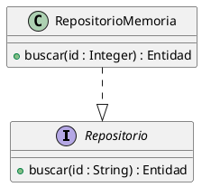

Esperado: `H2` con `cand = {buscar(Integer)}`.

### 8.3 Sobrecarga legítima (no reporta)

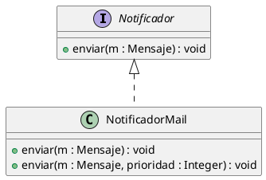

Esperado: **sin hallazgos**. Cubrir de más está permitido (p. 55).

### 8.4 Clase abstracta que difiere (no reporta como smell)

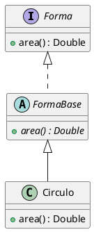

Esperado: `INFO_DIFERIDA` sobre `FormaBase`; `Circulo` sin hallazgos.

### 8.5 Visibilidad reducida (sí reporta)

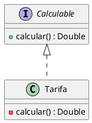

Esperado: `H3` (`+` → `-`).

### 8.6 Retorno covariante (no reporta)

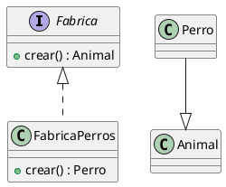

Esperado: **sin hallazgos**: el retorno es subtipo del declarado (`subTipo(Perro, Animal)`).

### 8.7 Retorno ajeno (sí reporta)

Ídem 8.6 pero `+crear() : String` → `H6`, con la aclaración de que `String` no está en la
jerarquía de `Animal`.

### 8.8 Interfaz sin cuerpo y *lollipop* (no reporta)

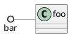

Esperado: `CONTRATO_DESCONOCIDO`, sin hallazgo. Se documenta como limitación (§9).

### 8.9 `implements` sobre una clase (no es CIM)

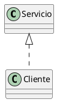

Esperado: `ADVERTENCIA_MODELO` («`Servicio` no está declarado como `interface`»), no `H1`–`H6`.

### 8.10 Interfaz que hereda de interfaz (fuera de esquema: no reporta herencia)

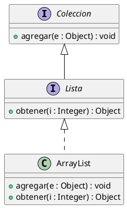

Esperado: **sin hallazgos**, pero por un motivo distinto al de una versión anterior de este
documento: el contrato de `Lista` es **sólo `obtener`** (§2.3, §4.3). `agregar` no se exige
por esa vía, así que la clase lo tenga o no es irrelevante para el veredicto.

Si `ArrayList` no declarara `obtener`, sí habría `H1`. Y si no declarara `agregar`, **no**
se reportaría nada: nuestro esquema no exige las operaciones de la superinterfaz.

### 8.11 Clase que implementa dos interfaces (se analiza sólo la primera)

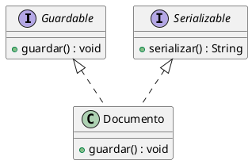

Esperado: **una sola evaluación**, contra `Guardable` (la primera de la declaración) →
conforme. `Serializable` queda como `NO_ANALIZADA`: **no** se reporta `H1` por `serializar`,
porque esa interfaz no entra en el análisis (§2.4).

Lo que **no** hace el detector: comparar los dos contratos entre sí, ni deducir que
`Documento` debería cubrir ambos con un solo método.

---

## 9. Límites y amenazas a la validez

Se documentan explícitamente porque condicionan cómo se leen las métricas del §10.

1. **Sólo se detecta lo que el diagrama declara.** Un diagrama que omite todos los miembros
   de la clase no permite concluir nada; el detector debe decir «sin información», no
   «conforme».
2. **Contrato desconocido**: interfaces sin cuerpo, *lollipop*, interfaces definidas en otro
   archivo. No verificables ⇒ no se reporta.
2.1. **Alcance recortado a propósito (§2.3)**: no se analiza la herencia entre interfaces ni
   la combinación de varios contratos sobre una misma clase. Un diagrama con jerarquías de
   interfaces puede producir hallazgos que un humano consideraría cubiertos por la
   superinterfaz; es el precio declarado del recorte, no un bug.
3. **Semántica no observable**: precondiciones, poscondiciones, invariantes y efectos no
   están en un diagrama de clases; el mismatch **semántico** queda fuera por definición.
4. **Genéricos**: se borran los parámetros de tipo (`List<T>` → `List`), lo que puede
   ocultar incompatibilidades de parametrización reales.
5. **Tipos sin jerarquía declarada**: si `Perro` y `Animal` no se relacionan en el diagrama,
   H6 no puede decidir y no reporta (falso negativo asumido, preferible al falso positivo).
6. **Visibilidad omitida**: no se infiere; sin declaración explícita no hay H3.
7. **Nombres no normalizados semánticamente**: `obtener` vs `get` es mismatch sintáctico
   según el contrato, aunque un humano lo considere cosmético. El reporte lo deja ver en la
   evidencia para que la revisión humana lo descarte.
8. **Diagramas como fuente de verdad parcial**: no hay cuerpo de métodos, por lo que no se
   distingue «implementación vacía» de «implementación correcta».

---

## 10. Plan de validación

Para sostener las heurísticas con datos y no con intuición:

1. **Corpus**: diagramas correctos (sin smell) + diagramas con CIM inyectado a mano.
2. **Operadores de mutación** (uno por heurística, para medir recall por separado):
   eliminar operación (H1), cambiar tipo o aridad de un parámetro (H2), bajar visibilidad
   (H3), marcar `{static}` (H4), dejar `{abstract}` en clase concreta (H5), cambiar retorno
   por un tipo ajeno a la jerarquía (H6).
3. **Métricas**: precisión y recall **por heurística** y globales; matriz de confusión con
   los falsos positivos clasificados por causa (interfaz externa, tipo no declarado,
   visibilidad omitida).
4. **Criterio de aceptación sugerido**: H1 con recall alto y precisión alta; H2–H6 con
   precisión prioritaria sobre recall (un hallazgo dudoso cuesta más que uno faltante en
   un informe defendido oralmente).
5. **Trazabilidad**: cada hallazgo del corpus debe poder explicarse con el campo
   `evidencia` del §7.1, sin leer el código del analizador.

---

## 11. Referencias

Las referencias bibliográficas y la versión de las fuentes son las de [CIM.md](./CIM.md),
§8:

1. Rumbaugh, J.; Jacobson, I.; Booch, G. — *El Lenguaje Unificado de Modelado. Manual de
   Referencia*, 2.ª ed., Addison-Wesley / Pearson Educación.
   ([Libro-UML.pdf](./Libro-UML.pdf))
2. *Diagramando UML con PlantUML — Guía de Referencia del Lenguaje PlantUML*, v1.2025.0.
   ([PlantUML_Guia.pdf](./PlantUML_Guia.pdf))
